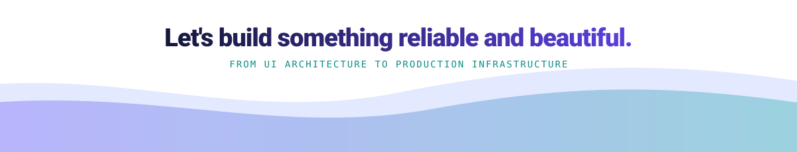

<picture>
  <source media="(prefers-color-scheme: dark)" srcset="./assets/hero-dark.svg">
  <source media="(prefers-color-scheme: light)" srcset="./assets/hero-light.svg">
  
</picture>

 

<picture>
  <source media="(prefers-color-scheme: dark)" srcset="./assets/divider-dark.svg">
  <source media="(prefers-color-scheme: light)" srcset="./assets/divider-light.svg">
  
</picture>

<h3>Impact in numbers</h3>
<picture>
  <source media="(prefers-color-scheme: dark)" srcset="./assets/stats-dark.svg">
  <source media="(prefers-color-scheme: light)" srcset="./assets/stats-light.svg">
  
</picture>

<picture>
  <source media="(prefers-color-scheme: dark)" srcset="./assets/divider-dark.svg">
  <source media="(prefers-color-scheme: light)" srcset="./assets/divider-light.svg">
  
</picture>

<h3>Skills</h3>
<picture>
  <source media="(prefers-color-scheme: dark)" srcset="./assets/skills-dark.svg">
  <source media="(prefers-color-scheme: light)" srcset="./assets/skills-light.svg">
  
</picture>

<picture>
  <source media="(prefers-color-scheme: dark)" srcset="./assets/divider-dark.svg">
  <source media="(prefers-color-scheme: light)" srcset="./assets/divider-light.svg">
  
</picture>

<h3>Experience</h3>
<picture>
  <source media="(prefers-color-scheme: dark)" srcset="./assets/experience-dark.svg">
  <source media="(prefers-color-scheme: light)" srcset="./assets/experience-light.svg">
  
</picture>

<picture>
  <source media="(prefers-color-scheme: dark)" srcset="./assets/divider-dark.svg">
  <source media="(prefers-color-scheme: light)" srcset="./assets/divider-light.svg">
  
</picture>

<h3>Education, certifications and languages</h3>
<picture>
  <source media="(prefers-color-scheme: dark)" srcset="./assets/credentials-dark.svg">
  <source media="(prefers-color-scheme: light)" srcset="./assets/credentials-light.svg">
  
</picture>

<picture>
  <source media="(prefers-color-scheme: dark)" srcset="./assets/divider-dark.svg">
  <source media="(prefers-color-scheme: light)" srcset="./assets/divider-light.svg">
  
</picture>

<a href="https://github.com/wurkloophq/gokashmir"><picture>
  <source media="(prefers-color-scheme: dark)" srcset="./assets/project-dark.svg">
  <source media="(prefers-color-scheme: light)" srcset="./assets/project-light.svg">
  
</picture></a>

 

<picture>
  <source media="(prefers-color-scheme: dark)" srcset="./assets/footer-dark.svg">
  <source media="(prefers-color-scheme: light)" srcset="./assets/footer-light.svg">
  
</picture>

